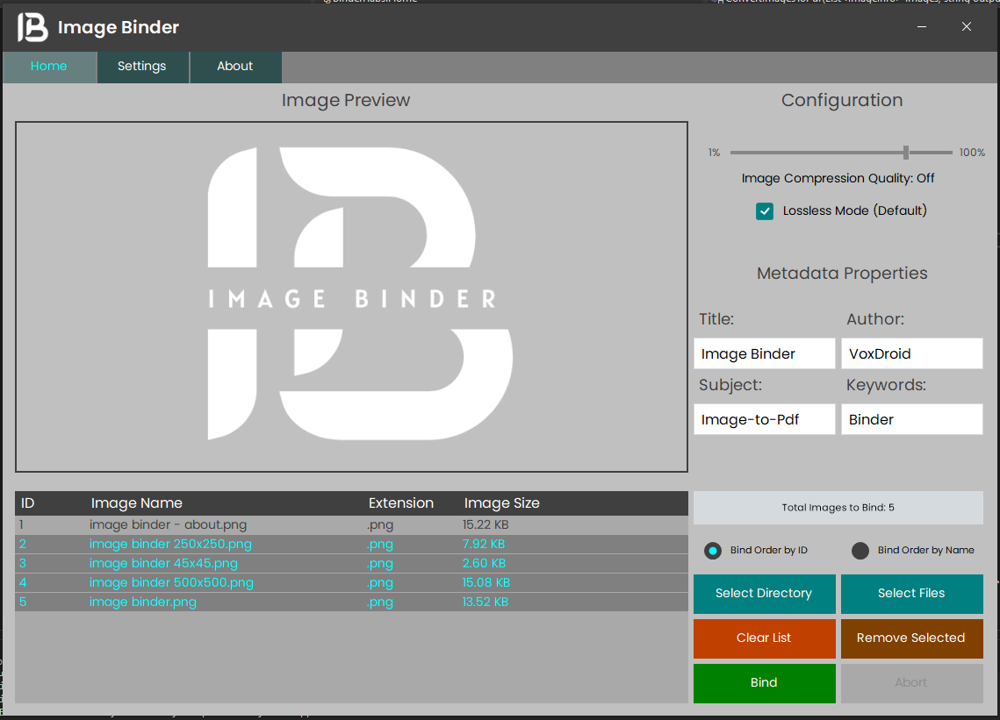

<h1 align="center">Image Binder</h1>

📒 Images-To-PDF Conversion 📒

  

  
  
  
  

## Table of Contents

- [Introduction](#introduction)
- [Features](#features)
- [System Requirements](#system-requirements)
- [Installation](#installation)
- [Getting Started](#getting-started)
- [Usage](#usage)
- [Demo](#demo)
- [Contributing](#contributing)
- [Security](#security)
- [Code of Conduct](#code-of-conduct)
- [Support](#support)
- [License](#license)
- [Acknowledgements](#acknowledgements)

## Introduction

**Image Binder** is a powerful and user-friendly Windows application designed to convert and combine multiple images into a single PDF document. Whether you're archiving photos, creating professional portfolios, or organizing scanned documents, Image Binder streamlines the process with an intuitive interface and robust features. Supporting popular image formats like JPG and PNG, it offers customizable compression, metadata embedding, and batch processing for efficient handling of large image collections.

Built with C# and leveraging libraries like PdfSharp and ImageMagick, Image Binder ensures high-quality output while maintaining performance. The application is open-source, actively maintained, and welcomes contributions from the community.

## Features

- **Customizable Image Compression:** Adjust compression quality (1-100%) to balance file size and visual quality, or opt for lossless mode to preserve original image fidelity.
- **Drag-and-Drop Support:** Add images or entire folders effortlessly by dragging and dropping them into the application.
- **Image Previews:** View thumbnails of selected images before binding, with double-click functionality to open original files or their directories.
- **Flexible Sorting Options:** Sort images by insertion order (Image ID) or alphabetically by name for customized PDF output.
- **Batch Processing:** Process multiple images from directories and subfolders in one go, ideal for large collections.
- **Metadata Customization:** Add PDF metadata such as title, author, subject, and keywords to enhance document organization and searchability.
- **Supported Formats:** Seamlessly handles JPG, JPEG, and PNG formats, with automatic validation of image extensions.
- **Always-on-Top Option:** Keep the application window on top for easy access during multitasking.
- **Tooltips:** Enable or disable informative tooltips to guide users through the interface, configurable via settings.
- **Background Processing:** Bind images asynchronously with a progress bar and cancellation support to prevent UI freezes.
- **Intuitive Interface:** Designed for ease of use, with clear controls and responsive feedback for a seamless experience.

## System Requirements

To run Image Binder, ensure your system meets the following requirements:

- **Operating System:** Windows 10 or later (64-bit recommended)
- **.NET Framework:** Version 4.7.2 or higher
- **Disk Space:** Approximately 50 MB for installation, plus additional space for temporary files during PDF creation
- **Memory:** 4 GB RAM minimum (8 GB recommended for large image collections)
- **Dependencies:** PdfSharp, ImageMagick, and iText libraries (bundled with the installer)

## Installation

Follow these steps to install Image Binder:

1. **Download the Installer:**
   - Visit the [Releases page](https://github.com/VoxDroid/Image-Binder/releases) on GitHub.
   - Download the latest `.msi` installer file.

2. **Run the Installer:**
   - Double-click the downloaded `.msi` file.
   - Follow the on-screen instructions to complete the installation.

3. **Verify Installation:**
   - Launch Image Binder from the Start Menu or desktop shortcut.
   - Ensure the application opens without errors.

> **Note:** Administrative privileges may be required to install the application.

## Getting Started

To start using Image Binder:

1. **Launch the Application:**
   - Open Image Binder from the Start Menu or desktop shortcut.

2. **Add Images:**
   - Drag and drop images or folders into the image list, or use the "Select Files" or "Select Folders" buttons.

3. **Configure Settings:**
   - Adjust compression quality using the slider (or enable lossless mode).
   - Set sorting preferences (by insertion order or name).
   - Optionally, add metadata like title, author, subject, and keywords.

4. **Bind Images:**
   - Click the "Bind" button to combine images into a PDF.
   - Choose the output file name and location in the save dialog.

5. **Review Output:**
   - Open the generated PDF to verify the results.

## Usage

### Adding Images
- **Drag and Drop:** Drop image files (JPG, JPEG, PNG) or folders into the image list area.
- **Select Files/Folders:** Use the "Select Files" button for individual images or "Select Folders" to include all images from a directory and its subfolders.
- **Validation:** The application automatically filters valid image formats and prompts to rename files with invalid characters (e.g., dots in filenames).

### Configuring Compression
- **Quality Slider:** Adjust the compression quality (1-100%) to control file size and image quality.
- **Lossless Mode:** Enable the "Lossless Mode" checkbox to retain original image quality (disables compression).
- **Preview:** Select an image to preview its appearance at the current quality setting.

### Sorting Images
- **By Insertion Order:** Select "Bind Option 1" to maintain the order images were added.
- **By Name:** Select "Bind Option 2" to sort images alphabetically by filename.
- Sorting updates the image list in real-time.

### Adding Metadata
- Enter metadata in the provided text fields:
  - **Title:** The document's title.
  - **Author:** The creator of the PDF.
  - **Subject:** A brief description of the content.
  - **Keywords:** Tags for searchability.
- Click the metadata label to clear all fields.

### Binding to PDF
- Click "Bind" to start the conversion process.
- A progress bar displays the status, and you can cancel the operation using the "Abort" button.
- The resulting PDF is saved to your chosen location with embedded metadata.

### Settings
- **Always on Top:** Enable to keep the window above others.
- **Tooltips:** Toggle to show or hide guidance tooltips.
- Settings are saved automatically and applied on application restart.

## Demo

  

The above screenshot showcases the Image Binder interface, highlighting the image list, preview pane, compression controls, and metadata fields.

## Contributing

We welcome contributions to Image Binder! To get involved:

- Check out the [Contributing Guidelines](CONTRIBUTING.md) for details on how to submit issues, feature requests, or pull requests.
- Fork the repository, make your changes, and submit a pull request.
- Ensure your code adheres to the project's [Code of Conduct](CODE_OF_CONDUCT.md).

## Security

Security is a priority for Image Binder. If you discover a vulnerability:

- Please report it privately as outlined in the [Security Policy](SECURITY.md).
- Do not disclose vulnerabilities publicly until they are addressed.

## Code of Conduct

To foster a welcoming community, all contributors and users are expected to follow the [Code of Conduct](CODE_OF_CONDUCT.md). This ensures respectful and inclusive interactions.

## Support

Need help with Image Binder? Visit the [Support page](SUPPORT.md) for resources, including:

- How to file bug reports or feature requests.
- Community forums and contact information.
- FAQs for common issues.

You can also support the project by donating via [Ko-fi](https://ko-fi.com/O4O6LO7Q1).

## License

Image Binder is licensed under the [MIT License](LICENSE). See the [LICENSE](LICENSE) file for details.

## Acknowledgements

- **PdfSharp**: For PDF creation and manipulation.
- **ImageMagick**: For advanced image processing.
- **iText**: For PDF metadata handling.
- **Guna.UI2**: For the modern UI framework.
- **VoxDroid**: For creating and maintaining Image Binder.
- **Contributors**: Thanks to all who have reported issues, suggested features, or contributed code.

---

  
<strong>Developed by <a href="https://github.com/VoxDroid">VoxDroid</a></strong>

  
Enjoying Image Binder? Consider supporting the project!

  

